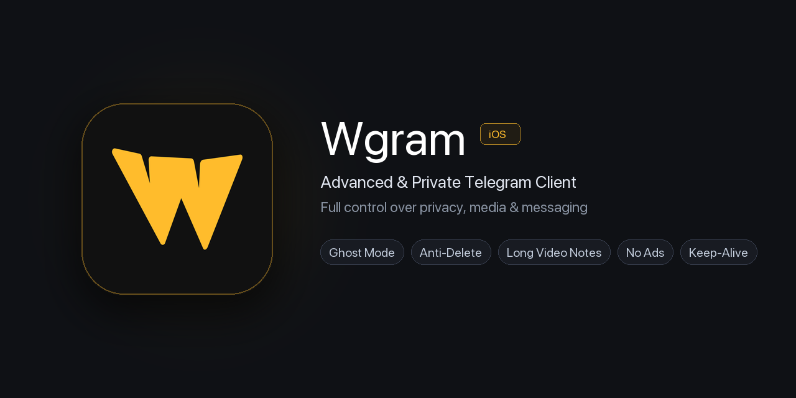

<div align="center">



<br/>
<br/>

# ⚡ Wgram for iOS

**Продвинутый, приватный и бескомпромиссный форк Telegram для iOS**

[](https://apple.com)
[](https://swift.org)
[](https://bazel.build)
[](LICENSE)

*Создан для тех, кому важен полный контроль над приватностью, контентом и общением.*

[Возможности](#-основные-возможности) • [Настройки Wgram](#-настройки-wgram-в-приложении) • [Сборка и установка](#-сборка-и-установка) • [Горячие клавиши и фишки](#-удобные-мелочи-qol)

---

</div>

## 🌟 Основные возможности

### 👻 Режим Призрака (Ghost Mode)
* **Полная невидимость в сети:** приложение блокирует отправку статуса онлайна и keepalive-пакеты MTProto. Вы всегда остаетесь «был(а) недавно» или в оффлайне, даже активно читая переписки.
* **Скрытное чтение сообщений:** входящие сообщения в личных диалогах, группах и каналах не помечаются прочитанными (две галочки у собеседника не загораются).
* **Скрытный просмотр историй (Stories):** автор истории никогда не увидит вас в списке просмотров.
* **Скрытное воспроизведение медиа:** голосовые сообщения и видео-кружочки не помечаются прослушанными.
* **Скрытие набора текста:** отключение индикаторов «печатает...», «записывает голосовое...», «выбирает фото...».
* **Чтение при действии (Mark Read After Action):** сообщение автоматически помечается прочитанным для собеседника только тогда, когда вы решите на него ответить или поставить реакцию.
* **Ghost Send:** безопасная отправка исходящих сообщений с моментальным возвратом в оффлайн-статус без утечки сетевой активности.

---

### 🗑️ Полный Антиделит (Anti-Delete) и История правок
* **Сохранение удаленных входящих сообщений:** если собеседник удаляет свое сообщение, оно не исчезает из вашего чата, а остается на месте и деликатно помечается значком корзины 🗑️.
* **Сохранение собственных удаленных сообщений:** если собеседник удаляет переписку «для всех», включая ваши исходящие сообщения — они остаются у вас в чате с отметкой об удалении.
* **Защита от полного сноса чата:** если собеседник очищает или удаляет весь диалог целиком, локальная история сообщений не теряется.
* **История редактирования сообщений (Edit History):** при изменении текста собеседником сохраняются все предыдущие версии. Вы можете в любой момент открыть историю правок по долгому тапу на сообщение.
* **Логирование в отдельный чат:** возможность автоматически дублировать все удаленные и отредактированные сообщения в «Избранное» (Saved Messages) или технический чат.

---

### ⏱️ Длинные видеосообщения и камера
* **Снятие ограничения в 60 секунд:** записывайте видео-кружочки длительностью 3, 5 или 10 минут одним дублем.
* **Умная нарезка (Split Long Video Notes):** кружочки длиннее 1 минуты автоматически разделяются на аккуратные непрерывные минутные части без швов и задержек звука.
* **Выбор камеры по умолчанию:** в настройках можно заранее выбрать, какая камера будет открываться первой при тапе на значок кружочка — **Фронтальная** или **Основная (задняя)**.

---

### 👁️ Обход ограничений контента (Bypass)
* **Обход таймера самоуничтожения (View-Once):** таймер с одноразовых фото и видео снимается. Медиа можно просматривать сколько угодно раз, увеличивать, делать скриншоты и сохранять в Фотопленку.
* **Скачивание историй (Stories Downloader):** кнопка прямой загрузки любых историй в галерею устройства в максимальном исходном качестве.
* **Обход защиты от копирования (Copy Protection Bypass):** свободное копирование текста, пересылка сообщений и сохранение медиа из закрытых каналов и чатов с запретом сохранения.

---

### 🔔 Фоновая работа 24/7 и прямые уведомления
* **Фоновый Keep-Alive:** поддержание активного соединения с серверами Telegram в фоне 24/7 (даже без официального Apple Developer аккаунта и при закрытом приложении).
* **Локальные Push-уведомления (Communication Notifications):** мгновенные уведомления о новых сообщениях с аватаром отправителя, возможностью быстрого ответа и интерактивного предпросмотра.

---

### 🛡️ Защита от случайных действий
* **Подтверждение отправки голосовых сообщений:** модальное окно подтверждения перед отправкой аудио.
* **Подтверждение отправки видеосообщений:** предотвращает случайную отправку недозаписанных кружочков.
* **Подтверждение отправки стикеров:** больше никаких случайных стикеров при случайном касании экрана.

---

### ⚡ Удобные мелочи (QoL)
* **Бесплатная встроенная расшифровка речи:** распознавание голосовых сообщений и кружочков в текст без подписки Telegram Premium.
* **Быстрый переход в начало диалога (Jump to Beginning):** мгновенная перемотка к первому сообщению в любом чате или канале через меню заголовка.
* **Дата регистрации аккаунта:** отображение примерной даты создания аккаунта собеседника в профиле на основе алгоритма анализа ID.
* **ID и Data Center (DC):** точный User ID / Chat ID и номер дата-центра отображаются прямо в профиле пользователя или группы.
* **Точное время сообщений:** показ секунд в таймстампах сообщений (`ЧЧ:ММ:СС`).
* **Блокировка рекламы:** скрытие официальных рекламных и спонсорских постов в публичных каналах.
* **Локальный Premium:** доступ ко всем системным премиум-иконкам приложения, кастомным эмодзи и оформлению.
* **Фирменный логотип Wgram:** глубокий графитовый фон со стилизованной золотистой литерой **W** в стиле iOS squircle установлен по умолчанию.
* **Неограниченное количество аккаунтов:** подключайте сколько угодно профилей без лимитов официального клиента.

---

## ⚙️ Настройки Wgram в приложении

Все параметры сгруппированы в удобном меню: **Настройки ➔ Настройки Wgram**:

| Раздел | Доступные параметры |
| :--- | :--- |
| **Режим Призрака** | Главный переключатель, Скрывать «В сети», Не читать сообщения, Не читать истории, Не слушать медиа, Не отправлять набор текста, Читать при действии, Ghost Send |
| **Антиделит и История** | Входящий антиделит, Сохранение своих сообщений, Сохранение при очистке чата, История редактирования, Исключения для чатов, Логирование в Избранное |
| **Кружочки и Видео** | Лимит длительности (1, 3, 5, 10 мин), Авто-разделение на части по 60 сек, Начальная камера (фронтальная / задняя) |
| **Медиа и Обход** | Обход таймера View-Once, Сохранение защищенного контента, Загрузка Stories в галерею |
| **Подтверждения** | Подтверждение аудио, Подтверждение видеосообщений, Подтверждение стикеров |
| **Интерфейс и Инфо** | Показ ID и DC, Точные секунды сообщений, Счетчик сообщений, Дата регистрации, Переход в начало |
| **Фон и Сеть** | Фоновый Keep-Alive 24/7, Локальные Push-уведомления, WebSocket прокси-туннель |

---

## 🛠️ Сборка и установка

### Системные требования
* macOS 14+ (Apple Silicon или Intel)
* Xcode 15+ с установленными Command Line Tools
* Python 3.10+
* Базовые утилиты: `git`, `bazel` (загружается автоматически через сборочный скрипт)

### 1. Клонирование репозитория
```bash
git clone --recursive https://github.com/sergetik52/Wgram.git
cd Wgram
```

### 2. Настройка конфигурации сборки
Сгенерируйте файл параметров или используйте файл разработчика:
```bash
cp build-system/template_minimal_development_configuration.json build-system/development_configuration.json
```
*(При необходимости укажите ваш Team ID и Bundle ID в файле конфигурации).*

### 3. Быстрая сборка и установка на подключенный iPhone
В репозиторий включен автоматический скрипт сборки и развертывания:
```bash
bash scripts/deploy_build.sh
```
Скрипт выполнит:
1. Инкрементальную компиляцию артефактов через Bazel (`debug_arm64`).
2. Упаковку итогового `Wgram.ipa` и сохранение на Рабочий стол (`~/Desktop/Wgram.ipa`).
3. Прямую установку и запуск приложения на подключенном iPhone через `xcrun devicectl`.

---

## ⚖️ Дисклеймер и безопасность

* Wgram является неофициальной модификацией Telegram для iOS и распространяется на условиях свободной лицензии **GNU General Public License v2.0**.
* Приложение взаимодействует с официальными серверами Telegram по протоколу MTProto без посредников. Ваши учетные данные, сессии и ключи сквозного шифрования (E2E) никогда не передаются третьим лицам.
* Проект не аффилирован с Telegram FZ-LLC или Telegram Messenger Inc.

---

<div align="center">
<b>Wgram</b> — бескомпромиссная свобода общения на iOS.
</div>
